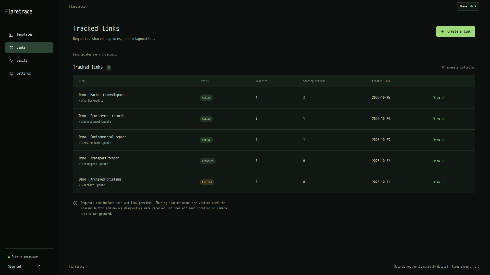
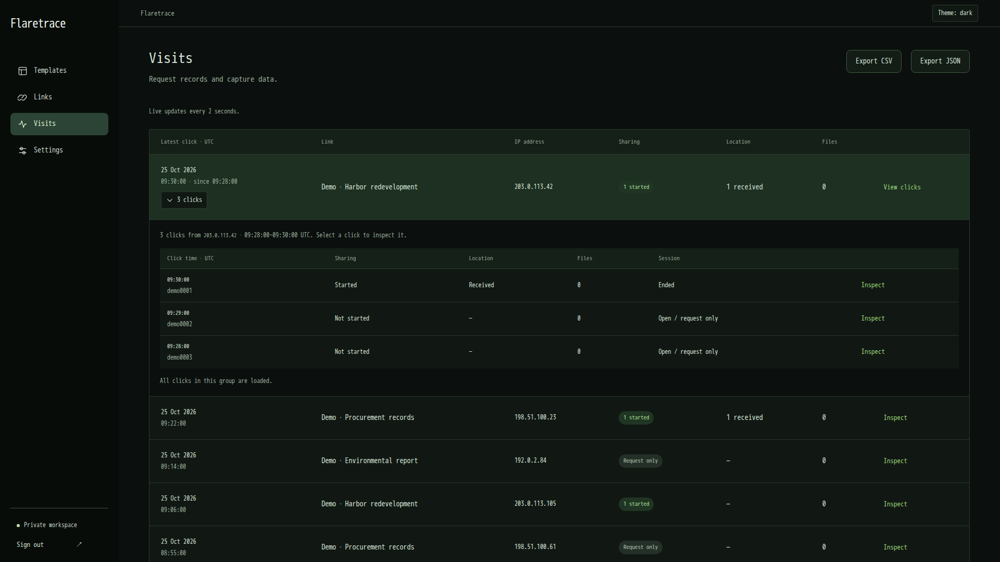
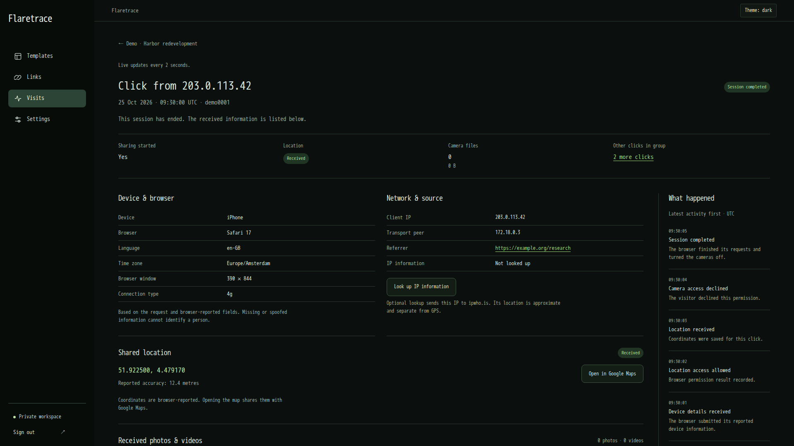

<p align="center">
  <picture>
    <source media="(prefers-color-scheme: dark)" srcset="assets/flaretrace-dark.svg">
    <source media="(prefers-color-scheme: light)" srcset="assets/flaretrace.svg">
    
  </picture>
</p>
<p align="center">
  <b>Tracking links for IP logging, GPS collection, camera captures, and browser insights.</b>
</p>
<p align="center">
  <a href="https://github.com/tijme/flaretrace/actions/workflows/ci.yml"></a>
  &nbsp;
  <a href="#usage"></a>
  &nbsp;
  <a href="#architecture"></a>
  &nbsp;
  <a href="LICENSE.md"></a>
</p>
<p align="center">
  <a href="#features">Features</a>
  &nbsp;•&nbsp;
  <a href="#usage">Usage</a>
  &nbsp;•&nbsp;
  <a href="#configuration">Configuration</a>
  &nbsp;•&nbsp;
  <a href="#maintenance">Maintenance</a>
  &nbsp;•&nbsp;
  <a href="#architecture">Architecture</a>
  &nbsp;•&nbsp;
  <a href="#issues--requests">Issues</a>
  &nbsp;•&nbsp;
  <a href="#license--copyright">License</a>
</p>

---

<table width="100%">
  <thead>
    <tr>
      <th align="center">Tracked links</th>
      <th align="center">Grouped visits</th>
      <th align="center">Visit inspector</th>
    </tr>
  </thead>
  <tbody>
    <tr>
      <td width="33%" valign="top"></td>
      <td width="33%" valign="top"></td>
      <td width="33%" valign="top"></td>
    </tr>
  </tbody>
</table>

## Features

- **Location evidence.** Collect browser-shared coordinates and accuracy.
- **Identity clues.** Review shared photos, silent video, and device details.
- **Network context.** Inspect IP addresses, browser metadata, and request headers.
- **Activity timelines.** Group repeat clicks and follow individual sessions.
- **Live inspection.** Review incoming evidence without refreshing the page.
- **Evidence exports.** Download investigation records as CSV or JSON.
- **Custom pages.** Reuse HTML/CSS templates for each investigation.
- **Private deployment.** Self-host with Docker and automatic HTTPS.
- **Click notifications.** Get a signed webhook the moment someone opens a link.
- **One-time & capped links.** Stop a link after a fixed number of real visits; automated hits never count toward the limit.
- **Bot & preview filtering.** Crawlers and link-preview fetches are flagged automatically and can be hidden from the visit list.
- **Printable QR codes.** Share a link in person with a scannable, downloadable SVG code.
- **Campaign reporting.** Group links into a campaign for one aggregate view and export.
- **Visit notes.** Annotate individual clicks with administrator-only notes, included in exports.

## Usage

<details>
<summary><strong>Quick start (<code>HTTP</code> only)</strong></summary>
<hr>

Pull the Docker image:

```sh
docker pull ghcr.io/tijme/flaretrace:latest
```

Run the image <small>(and bind host port 80 to container port 80)</small>:

```sh
docker run -d --rm --name flaretrace -p 80:80 -v ./flaretrace-data:/data ghcr.io/tijme/flaretrace:latest
```

Print the generated username & password to the console:

```sh
docker exec flaretrace manage credentials
```

Open [http://localhost/admin](http://localhost/admin) and sign in with the generated credentials.

<hr>
</details>

<details>
<summary><strong>Quick start (<code>HTTP</code> & automatic <code>HTTPS</code>)</strong></summary>
<hr>

Point a DNS hostname at the server and allow inbound TCP ports 80/443; UDP 443 additionally enables HTTP/3:

Pull the Docker image:

```sh
docker pull ghcr.io/tijme/flaretrace:latest
```

Run the image <small>(and bind host port 80 & 443 to container port 80 & 443)</small>:

```sh
docker run -d --rm --name flaretrace -p 80:80 -p 443:443 -p 443:443/udp -v ./flaretrace-data:/data ghcr.io/tijme/flaretrace:latest --domain example.com --auto-tls
```

Open `https://example.com/admin`. The bundled Caddy process obtains and renews Let's Encrypt certificates; HTTP redirects preserve the request path and query. Omit `--auto-tls` to serve the domain over HTTP. Browser location and camera sharing require HTTPS or localhost, explicit visitor action, and browser permission.

<hr>
</details>

## Configuration

<details>
<summary><strong>Container arguments</strong></summary>
<hr>

Show the available commands and configuration options:

```sh
docker run --rm ghcr.io/tijme/flaretrace:latest --help
```

| Argument | Default | Purpose |
| --- | --- | --- |
| `serve` | Default command | Initialize storage and supervise the bundled proxy and app. |
| `credentials` | — | Print the administrator username and existing generated password; never replace either. |
| `healthcheck` | — | Probe both the backend and proxy using SQLite-backed readiness. |
| `--domain HOST` | Unset | Public hostname used for shared links and TLS. |
| `--auto-tls [0\|1]` | Off | Obtain and renew public HTTPS certificates; requires a DNS hostname. |
| `--no-auto-tls` | — | Explicitly disable an environment-provided TLS default. |
| `--http-port PORT` | `80` | Container HTTP listener. Publish it explicitly with Docker `-p`. |
| `--https-port PORT` | `443` | Container HTTPS TCP/UDP listener and redirect port. |
| `--public-base-url URL` | Inferred | Override the shared-link origin behind another ingress. |
| `--data-dir PATH` | `/data` | Dedicated persistent directory. Mount it; do not use a broad system directory. |
| `--admin-username NAME` | `admin` | Administrator login name. |
| `--admin-password-file PATH` | Unset | Read a password from a mounted, read-only secret file. Minimum 12 characters. |
| `--admin-password VALUE` | Generated | Explicit password; a mounted secret avoids shell-history exposure. |
| `--uid UID`, `--gid GID` | `10001` | Non-root serving account after storage bootstrap. Root is never accepted here. |
| `--repair-storage` | Off | Force a full ownership scan without deleting evidence or regenerating credentials. |
| `--tls-issuer internal` | Public ACME | Development-only CA with `--auto-tls`; its certificates are not publicly trusted. |

Explicit arguments override legacy `DOMAIN`, `AUTO_TLS`, `HTTP_PORT`, `HTTPS_PORT`, `PUBLIC_BASE_URL`, `ADMIN_USERNAME`, `ADMIN_PASSWORD`, and `DATA_DIR` values. Existing `SITE_ADDRESS` origins remain supported when no domain is given. Environment variables and `.env` files are not required. Docker options belong **before** the image name; Flaretrace arguments belong **after** it.

Bootstrap checks actual ownership of credentials, SQLite files, and private directories on every start. A stale ownership marker cannot bypass a needed repair. Existing signing keys, passwords, records, and media are preserved. Both Caddy and Gunicorn then run without root; Tini reaps processes and the supervisor stops the container if either required service exits.

Mount only a dedicated application-data directory. For bind mounts, bootstrap may change its ownership to the chosen UID/GID. An explicit `--user` non-root launch must already have accessible storage and matching `--uid`/`--gid`; it cannot repair another user's files.

Standard Docker networking lets the non-root proxy use ports 80/443 without extra flags or privileges. If another runtime or a hardened policy rejects low ports, use `--http-port 8080 --https-port 8443` and matching Docker mappings instead. Rootless engines may separately restrict low **host** ports; publish high host ports or route an existing ingress to the container. Do not use host networking for the standard examples.

<hr>
</details>

<details>
<summary><strong>Saved landing templates</strong></summary>
<hr>

The bundled **Human Verification Captcha** option is a consent page, selected by default when creating a link. Its visitor-facing controls clearly describe location and camera sharing. Edit [human-verification-captcha.html](src/flaretrace/landing_templates/human-verification-captcha.html) to customize it; the `EDIT PRIVACY INFORMATION BELOW` comment marks the privacy section.

Rebuild the image after changing that file. On startup, untouched library copies receive the updated HTML. Administrator edits and deletions are preserved, and existing links keep their saved content. To apply changes to existing links, edit and save their template in the admin panel. **Blank template** remains available.

```html
<button id="enable-button" type="button">Share location and camera</button>
<button id="stop-button" type="button">Stop sharing</button>
```

Manage reusable templates in the admin panel. Templates can be up to 10 MB (10,000,000 UTF-8 bytes). HTML is saved and served exactly as entered, including scripts, styles, forms, SVGs, and external assets. Flaretrace appends its runtime script at the end: `enable-button` starts the disclosed sharing flow; `disable-button` or `stop-button` declines/stops it. Administrator previews run in an isolated sandbox with location and camera access disabled. Disclose the requested collection clearly and never misrepresent permission requirements.

<hr>
</details>

<details>
<summary><strong>Optional Compose and source builds</strong></summary>
<hr>

Start the optional [Compose example](compose.yaml), which runs the same **single** image with one persistent volume:

```sh
docker compose up -d
```

Print the generated username & password to the console:

```sh
docker compose exec flaretrace manage credentials
```

No extra services, profiles, mounted scripts, or mounted proxy configuration are needed.

Build a local image from your checkout:

```sh
docker build -f deploy/Dockerfile -t flaretrace-local .
```

Run the local image <small>(and bind localhost port 8000 to container port 80)</small>:

```sh
docker run -d --name flaretrace -p 127.0.0.1:8000:80 -v flaretrace-data:/data flaretrace-local
```

<hr>
</details>

## Maintenance

<details>
<summary><strong>Lifecycle, logs, and upgrades</strong></summary>
<hr>

Stop the container gracefully:

```sh
docker stop flaretrace
```

Start an existing stopped container with its saved arguments:

```sh
docker start flaretrace
```

Restart the container with the same image and configuration:

```sh
docker restart flaretrace
```

Follow app, proxy, and startup logs:

```sh
docker logs --tail 100 -f flaretrace
```

Check that both services are ready <small>(exit code 0 means healthy)</small>:

```sh
docker exec flaretrace manage healthcheck
```

Print the generated username & password to the console:

```sh
docker exec flaretrace manage credentials
```

In `docker exec flaretrace manage credentials`, `flaretrace` is the container name, `manage` is the executable inside it, and `credentials` is its command. `docker exec` runs an additional process without changing the container entrypoint. The output includes `Username: admin` (or your configured username) and `Password: …`. Explicit passwords supplied at startup are not displayed.

To upgrade, pull the chosen image tag, stop and remove **only the container**, then repeat your run command with the same data volume and arguments. Do not pass `-v` to `docker rm`, delete the data volume, or replace its signing key. A restart does not switch image versions.

Pull the latest image for a Compose installation:

```sh
docker compose pull
```

Recreate the Compose container with the updated image:

```sh
docker compose up -d
```

`--http-port`, `--https-port`, and other arguments are saved in the container's configuration; repeat them when creating a replacement container. GitHub Actions publishes images but does not deploy to your server.

<hr>
</details>

<details>
<summary><strong>Migrate the previous multi-container installation</strong></summary>
<hr>

Back up first, then stop the previous installation using the **old** Compose file:

```sh
docker compose down
```

Do not add `--volumes`: old named volumes and bind-mounted records must remain intact. Preserve your existing administrator credential and homepage settings.

Mount the existing data directory directly into the new image, replacing the example source path with its absolute location:

```sh
docker run -d --name flaretrace --restart unless-stopped -p 80:80 -p 443:443 -p 443:443/udp --mount type=bind,source=/absolute/path/to/flaretrace/data,target=/data ghcr.io/tijme/flaretrace:latest --domain trace.example.com --auto-tls
```

Replace the hostname with your existing domain. Startup repairs ownership from previous installations automatically, even with old marker files present. Existing records and secrets are preserved.

To reuse old Caddy certificate storage, additionally mount the old `tls/caddy` directory at `/data/tls`. Otherwise the bundled Caddy obtains fresh certificates; keep the old directory backed up to avoid unnecessary issuance. Older named-volume installations can mount their existing application-data volume at `/data` instead of a bind mount. Do not mount an empty directory over existing evidence or import a production volume into CI.

<hr>
</details>

<details>
<summary><strong>Backups and retention</strong></summary>
<hr>

These commands require a container created without `--rm`, so it remains available after stopping.

Stop the container so the SQLite database and WAL files form a consistent snapshot:

```sh
docker stop flaretrace
```

Back up the entire `/data` volume to `flaretrace-backup.tar.gz` <small>(the image includes `tar`)</small>:

```sh
docker run --rm --volumes-from flaretrace:ro --entrypoint tar ghcr.io/tijme/flaretrace:latest -C /data -czf - . > flaretrace-backup.tar.gz
```

Start the container again:

```sh
docker start flaretrace
```

Verify and protect the backup: it contains credentials, IP addresses, coordinates, media, and certificate private keys. Restore into a dedicated empty volume while Flaretrace is stopped. Records remain until explicitly deleted; link expiration stops new visits but does not delete evidence. Legacy automatic cleanup remains disabled.

<hr>
</details>

<details>
<summary><strong>Containerized tests and image publishing</strong></summary>
<hr>

Build the test image with Python, Node, and browser dependencies:

```sh
docker build -f deploy/ci/Dockerfile --target ui -t flaretrace-ci-ui .
```

Run all application checks and save reports under `artifacts/ci`:

```sh
docker run --rm --init --shm-size=1g -v "$PWD/artifacts/ci:/workspace/artifacts/ci" flaretrace-ci-ui all
```

Unit, feature, JavaScript, browser, and documentation checks run inside the test image. Python statements and branches and JavaScript statements, lines, functions, and branches must each reach **90%** overall; required documentation contracts must reach **100%**. The separate [image integration suite](tests/image/test_distribution.py) verifies the actual distribution's HTTP, hostname-verified HTTPS, private backend, administrator flow, and automatic ownership repair.

Only after all checks pass does GitHub Actions publish the multi-platform image to GHCR, with SBOM/provenance and a recorded digest. Pull requests never publish. See the [CI workflow](.github/workflows/ci.yml) and [documentation checks](tests/documentation/).

<hr>
</details>

## Architecture

<details>
<summary><strong>One runtime image and one persistent volume</strong></summary>
<hr>

| Component | Responsibility |
| --- | --- |
| Tini and [runtime supervisor](src/flaretrace/runtime/) | Reap children, forward signals, stop the container on either service's failure. |
| [Container entrypoint](src/flaretrace/runtime/cli.py) | Parse arguments, initialize storage, drop root, and implement credentials/readiness commands. |
| [Storage bootstrap](src/flaretrace/runtime/storage.py) | Check real critical-file ownership, reject dangerous paths, preserve credentials and evidence. |
| [Bundled Caddy configuration](src/flaretrace/runtime/proxy.py) | HTTP/HTTPS, certificate renewal, redirects, and the only public listener. |
| [Python application](src/flaretrace/) | Existing admin panel, visitor capture, SQLite migrations, exports, media, and web assets. |
| `/data` | Database, media, signing key, generated password, and `tls/` certificate state. |

Gunicorn listens only on the container's loopback interface. The published image contains every required executable, configuration generator, schema, template, font, and browser script. No Docker socket, host helper, separate Caddy container, or separate initialization container is used in production. CI images are development tooling, not additional production services.

Source is organized under `src/flaretrace/`; image definitions live under `deploy/`; categorized tests under `tests/`; GitHub build/test/publish automation under `.github/`; and README images under `assets/`. The optional Compose file describes one service, not an alternative runtime architecture.

<hr>
</details>

## Issues & requests

Report bugs and feature requests through the [GitHub issue tracker](https://github.com/tijme/flaretrace/issues). Search existing issues first, then include reproduction steps, expected behavior, and relevant application or proxy logs. Remove passwords, tokens, and visitor data from logs before posting them.

## License & copyright

&copy; 2026 Tijme Gommers and contributors. Licensed under the [GNU General Public License v3.0](LICENSE.md).

Bundled dependencies and assets retain their own license and copyright notices. DM Sans is distributed under the [SIL Open Font License](src/flaretrace/static/fonts/OFL.txt); the SVG banners preserve the embedded attribution and license for their glyph outlines.

The image includes Caddy under [Apache-2.0](deploy/licenses/CADDY-LICENSE) and Tini with its packaged distribution notices. Their licenses remain separate from the Flaretrace application license.
